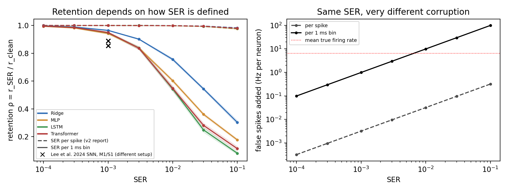

# Spike-error tolerance of rate-based motor decoders

How much spike-transmission error (SER) can a rate-based motor decoder tolerate before its accuracy drops?
Motivated by the ASBIT event-driven wireless network of Lee et al., *Nature Electronics* 7, 313–324 (2024).

**Report:** [`report/report_v3.pdf`](report/report_v3.pdf)

## Main results (CRCNS pmd-1, 161 units, 496 trials, trial-level 5-fold CV)

| | Ridge | MLP | LSTM | Transformer |
|---|---|---|---|---|
| Clean r (mean vx, vy) | 0.858 | 0.907 | 0.903 | 0.896 |
| Retention at SER 1e-2, errors per spike | 0.998 | 0.998 | 0.998 | 0.998 |
| Retention at SER 1e-2, errors per 1-ms bin | 0.756 | 0.602 | 0.542 | 0.547 |

- The SER definition dominates: per 1-ms bin, SER 1e-2 adds ~9.9 Hz of false spikes per neuron; per spike, ~0.03 Hz.
- 20-ms bins + output smoothing raise Ridge retention at SER 1e-2 from 0.758 to 0.840 with no loss of clean accuracy.
- Retention does not rise with the number of units (N = 20 → 161).

## Reproduce

1. Get `MM_S1_processed.mat` (see [`data/README.md`](data/README.md)).
2. Open [`ser_tolerance_v3.ipynb`](ser_tolerance_v3.ipynb) in Google Colab (T4 GPU), set `CONFIG['MAT_PATH']`, run all.
   About 25 min with all four decoders; set `RUN_DEEP=False` for Ridge + MLP only.
3. The notebook writes `results/` (figures, `results.json`, `macros.tex`). `report/report_v3.tex` reads every number
   from `results/macros.tex` and `results/derived.tex`.

`ser_tolerance_v3.py` is the same code as a plain script.

## Methods in one paragraph

Causal 200-ms window (20 × 10-ms bins) built inside each trial; folds split by trial; decoders trained once on clean
data and evaluated on corrupted test trials (5 corruption draws per fold and SER level). Two error models: per spike
(SER = (misses + false spikes) / spikes) and per 1-ms bin (each 1-ms slot is in error with probability p).
95% bootstrap CIs; Fisher-z paired t-tests with Benjamini–Hochberg correction.

## Limitations

One monkey, one session; i.i.d. errors; no SNN or ASBIT channel simulation; 10-ms data emulate 1-ms errors.

## Citation

Jihun Yu (2026). *How much spike-transmission error can a rate-based motor decoder tolerate?* Draft v3.
